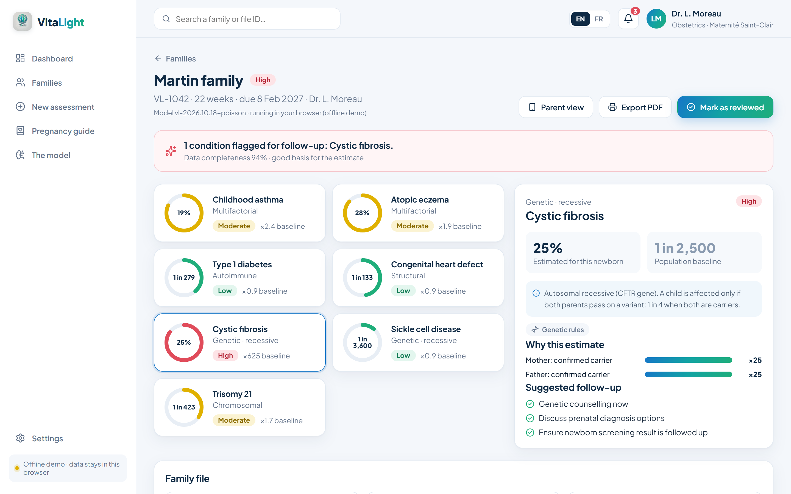
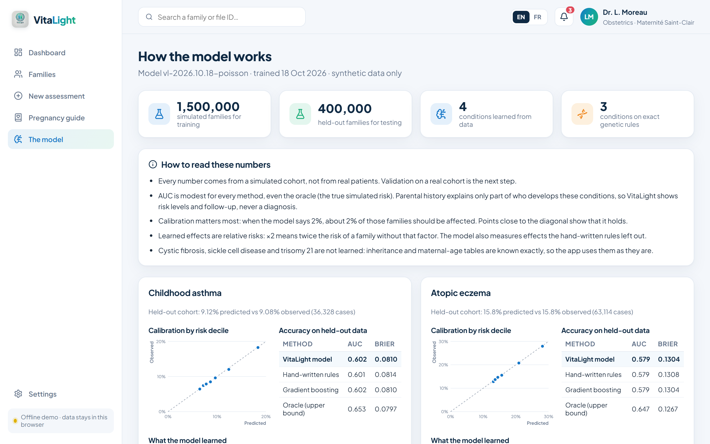

# VitaLight

**Illuminating Future Health.** VitaLight, the preventive-health concept from Microsoft Imagine Cup 2025, built
out as a working system. Clinicians enter both parents' medical history. A Python API stores the file, runs a
trained model, and returns newborn health-risk estimates with an explanation for each one. A parent app then
turns the report into plain language and a weekly pregnancy guide.

> Synthetic data only. Risk figures are illustrative orders of magnitude, not a diagnosis and not a medical
> device.

| Risk report | Model card |
|---|---|
|  |  |

```
 React + TypeScript (Vite)                 FastAPI (Python)                         SQLite / PostgreSQL
 ┌──────────────────────────┐   /api   ┌──────────────────────────────────┐    ┌──────────────────────┐
 │ clinician app, parent app│ ───────▶ │ auth · consent · audit log       │ ─▶ │ families, assessments│
 │ EN/FR, offline fallback  │          │ trained model (multifactorial)   │    │ users, audit_log     │
 └──────────────────────────┘          │ exact genetic rules (CF, SCD, T21)│    └──────────────────────┘
                                       └──────────────────────────────────┘
```

## Run it

Prerequisites: Node 22 and Python 3.11.

```bash
npm install
pip install -r api/requirements-dev.txt

# Option A: development (hot reload, two terminals)
npm run api          # FastAPI on http://127.0.0.1:8000 (API docs at /docs)
npm run dev          # http://localhost:5180, /api is proxied to the Python server

# Option B: the whole system in one process
npm run build && npm run api      # open http://127.0.0.1:8000

# Option C: Docker (one container, data in a volume)
docker build -t vitalight .
docker run -p 8000:8000 -v vitalight-data:/data -e VITALIGHT_SECRET=change-me vitalight
```

Demo sign-in: `l.moreau@vitalight.demo`, `s.haddad@vitalight.demo` or `a.petit@vitalight.demo`, password
`vitalight-demo`. The database is created and seeded with 8 fictional families on first start.

**Offline mode.** When no API answers (for example on GitHub Pages), the frontend runs on its own: the same
synthetic families, and the **same trained model** running in the browser from the JSON artifact
(`src/lib/ml.ts`). Nothing is stored and there is no sign-in. The sidebar chip shows which mode is active.

## Checks

```bash
npm test             # 38 API, model and parity tests (pytest)
npm run golden       # re-export the browser engine and model outputs used by the parity tests
node scripts/e2e.mjs # browser test of the full system (needs the server on :8000)
npm run typecheck
```

The parity tests run the TypeScript rules and the in-browser model on 11 families and require the Python side
to give the same risks, levels, factors and recommendations, so the offline demo and the server can't drift
apart. The end-to-end test signs in, opens a report from the trained model, creates a family, reviews it,
reloads to confirm it was saved, opens the model card and the activity log, and checks that the form blocks a
run without parental consent.

## The model

Each condition uses the method that fits its biology:

| Conditions | Method | Why |
|---|---|---|
| Asthma, atopic eczema, type 1 diabetes, congenital heart defect | **Trained model**: log-linear Poisson regression (scikit-learn) | Multifactorial: effect sizes have to be estimated from data |
| Cystic fibrosis, sickle cell disease | **Genetic rules**: carrier probabilities, 1 in 4 when both parents carry | Mendelian inheritance is exact; learning it would only add noise |
| Trisomy 21 | **Genetic rules**: maternal-age table | Known actuarial relationship |

**Why Poisson regression.** For binary outcomes, "modified Poisson" regression is a standard epidemiology
method. Its exp(coefficient) is directly a relative risk, which is exactly what the report's factor bars show.
The explanation is therefore the model itself, not a post-hoc approximation.

**Training data.** No real patient data exists for this project, so `vitalight/simulate.py` generates a
synthetic cohort. Its "ground truth" is deliberately richer than anything the model can see: interactions
(two atopic parents, diabetes × heart defect), unobserved family-level variation, and weak effects that the
hand-written rules ignore. Rare exposures are over-sampled to 15% and importance-weighted back to population
prevalence. Without the weights, strong co-occurring factors hit the risk caps far too often and the rare
conditions came out over-predicted by about 40%.

**Results** on a held-out cohort of 400,000 families at population prevalence (`api/models/vitalight-model.json`,
also served at `GET /api/model`):

| Condition | AUC model | AUC rules | AUC oracle* | Mean predicted vs observed |
|---|---|---|---|---|
| Asthma | 0.602 | 0.601 | 0.653 | 9.1% vs 9.1% |
| Eczema | 0.579 | 0.579 | 0.647 | 15.8% vs 15.8% |
| Type 1 diabetes | 0.575 | 0.568 | 0.575 | 0.42% vs 0.40% |
| Heart defect | 0.566 | 0.559 | 0.566 | 0.90% vs 0.90% |

\* The oracle is the true simulated risk, an upper bound no model can beat.

How to read this honestly:
- **Discrimination is modest for every method, including the oracle.** Parental history explains only a small
  part of who gets these conditions. That is the real clinical picture, and it is why VitaLight presents risk
  levels and follow-up suggestions, not predictions.
- **The model matches the oracle for T1D and heart defects and is well calibrated everywhere.** For asthma and
  eczema the remaining gap is the unobserved family-level factor, which no model built on this input can recover.
- **Gradient boosting and logistic regression score the same** (see the model card), so the explainable
  model costs nothing in accuracy.
- **Known limits:** it is a main-effects model, so it misses the diabetes × heart-defect interaction. The
  mother-with-T1D effect is underestimated (×3.8 vs ×7 simulated) because only 0.5% of mothers have T1D. And
  every number comes from a simulation, so external validation on a real cohort is the next step.

Retrain with `npm run train`. It takes about a minute and writes a new versioned artifact. Stored assessments
keep the model version that produced them, and `POST /api/families/{id}/reassess` reruns a file on the
current model.

## API

| Method & path | What it does |
|---|---|
| `GET /api/health` | Status, model version, engine in use |
| `POST /api/auth/login` | Email and password → bearer token (12 h). 5 failures in 15 min lock that email from that address for 15 min |
| `GET /api/model` | Model card: training data, metrics vs benchmarks, calibration, learned relative risks |
| `GET /api/families` · `GET /api/families/{id}` | Files with their latest assessment |
| `POST /api/families` | Create and assess a file (**rejected without parental consent**) |
| `POST /api/families/{id}/review` | Mark as reviewed, which shares the report with the parents |
| `POST /api/families/{id}/reassess` | Rerun the current model, keeping the history |
| `DELETE /api/families/{id}` | Right to erasure (GDPR art. 17) |
| `POST /api/assess` | What-if assessment, nothing stored |
| `GET /api/audit` | Access log: who read, created, reviewed or deleted what, and when |

Interactive docs: `/docs`. Configuration is through environment variables: `VITALIGHT_DB` (SQLAlchemy URL),
`VITALIGHT_SECRET` (token signing key; set it in production), `VITALIGHT_CORS`, `VITALIGHT_SEED`,
`VITALIGHT_DEMO_PASSWORD`, plus `VITE_API_URL` at frontend build time when the API runs on another host.

## Screens

| Route | What it shows |
|---|---|
| `#/` | Landing page: problem, how it works, technology |
| `#/app` | Clinician dashboard: KPIs, recent assessments, cohort by attention level (sign-in required when online) |
| `#/app/families` | Family files with level filter |
| `#/app/new` | 5-step assessment form with consent checkbox ("Fill with example" for demos) |
| `#/app/report/:id` | Risk report: 7 conditions, risk vs. baseline, factor breakdown, method and model version, follow-up |
| `#/app/parent/:id` | Parent mobile app: plain-language report, pregnancy guide, notification inbox, push demo |
| `#/app/guide` | Pregnancy guide (eat well / avoid / habits, with sources) and the weekly push schedule |
| `#/app/model` | Model card: held-out accuracy vs rules, boosting and oracle, calibration plots, learned relative risks |
| `#/app/activity` | Activity log from the server's audit trail (online only) |

## Structure

```
api/
  vitalight/main.py      routes, static frontend hosting
  vitalight/engine.py    reference rules (exact port of src/lib/model.ts) + genetics
  vitalight/features.py  model features, shared by training and serving
  vitalight/simulate.py  synthetic cohort ("ground truth")
  vitalight/train.py     training, benchmarks, model card
  vitalight/ml.py        serving: JSON artifact -> ConditionResult[]
  vitalight/db.py        SQLAlchemy models, audit helper
  vitalight/auth.py      PBKDF2 passwords, HMAC-signed tokens
  vitalight/seed.py      demo accounts and families
  models/                versioned model artifact (JSON, no pickle)
  tests/                 API, model and parity tests
src/
  lib/api.ts             API client, health probe
  lib/store.tsx          online/offline state, auth, families, alerts, toasts
  lib/model.ts           reference rules, genetics and shared types
  lib/ml.ts              the trained model in the browser (reads api/models/vitalight-model.json)
  pages/                 one file per screen, plus Login, ModelCard and Activity
  i18n/                  EN/FR strings (TypeScript checks both have the same keys)
scripts/
  e2e.mjs                full-system browser test
  export-golden.mjs      TypeScript engine outputs for the parity test
  screenshots.mjs        portfolio screenshots (2880x1800, EN and FR)
```

## Deploy

- **GitHub Pages (public demo).** `.github/workflows/pages.yml` builds the frontend and publishes it on every
  push to `main`. One-time setup: in the repository, go to Settings > Pages and set Source to "GitHub Actions".
  The page runs in offline mode, with the trained model in the browser.
- **Full system.** The Docker image runs anywhere containers run (Azure Container Apps or App Service, Render,
  Fly.io). Set `VITALIGHT_SECRET`, mount a volume on `/data` (or point `VITALIGHT_DB` at PostgreSQL), and
  change `VITALIGHT_DEMO_PASSWORD` before the first start.
- **CI.** `.github/workflows/ci.yml` runs the parity export, the tests, the build, a dev-server check and the
  Docker build on every push.

## Languages

English by default, with the EN/FR switch in the top bar, on the landing page and on the sign-in screen. Medical
content stores both languages side by side as `{ en, fr }`, and the API returns the same bilingual labels.
Numbers, percentages and dates follow each language's conventions.

## Research behind the guide

- Marshall NE et al. *The importance of nutrition in pregnancy and lactation: lifelong consequences.*
  Am J Obstet Gynecol 2022;226(5):607–632. https://doi.org/10.1016/j.ajog.2021.12.035
- Koletzko B et al. *Nutrition during pregnancy, lactation and early childhood and its implications for maternal
  and long-term child health: the EarlyNutrition project recommendations.* Ann Nutr Metab 2019;74(2):93–106.
  https://doi.org/10.1159/000496471
- MRC Vitamin Study Research Group. *Prevention of neural tube defects.* Lancet 1991;338:131–137.
  https://pubmed.ncbi.nlm.nih.gov/1677062/
- WHO (2016). *Recommendations on antenatal care for a positive pregnancy experience.*
- NHS. *Foods to avoid in pregnancy.* https://www.nhs.uk/pregnancy/keeping-well/foods-to-avoid/

## Still to do

1. **Real push notifications:** service worker + Web Push (or Azure Notification Hubs), with a backend job
   that sends the weekly schedule. The schedule logic exists; today the demo plays it in the UI.
2. **Parent accounts:** parents currently see their report through the clinician's "Parent view". They need
   their own sign-in, scoped to their file.
3. **Production identity and hosting:** Microsoft Entra ID instead of the built-in login, PostgreSQL,
   HDS-certified hosting (Azure France Central), and per-clinician access rules (today any signed-in clinician
   sees every file).
4. **External validation** of the model on a real cohort, with clinical review of the effect sizes.
